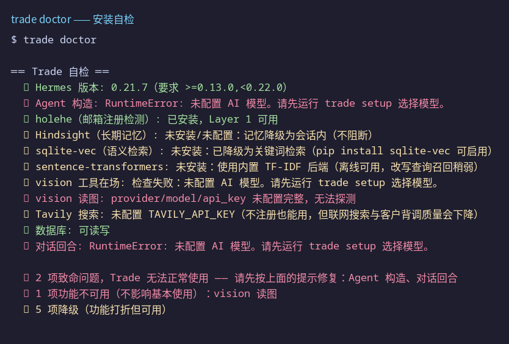
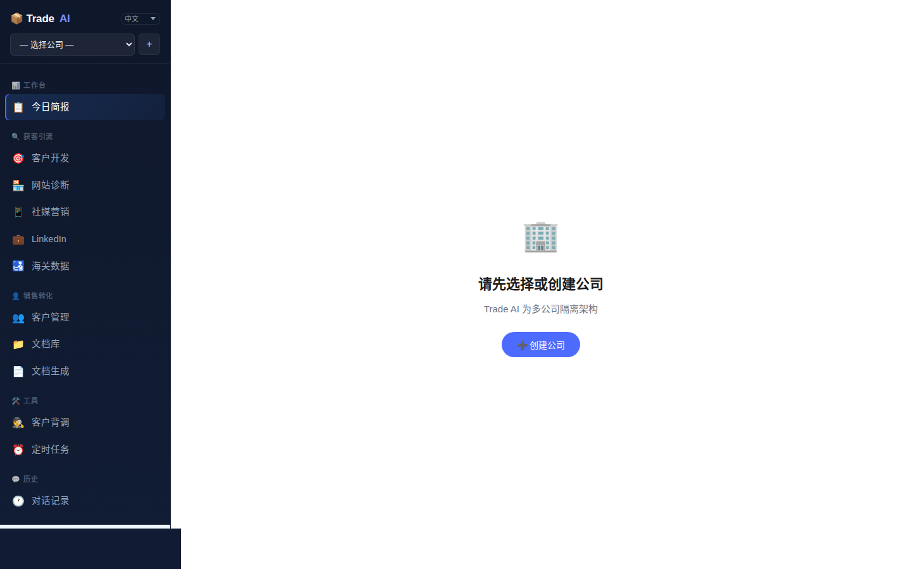
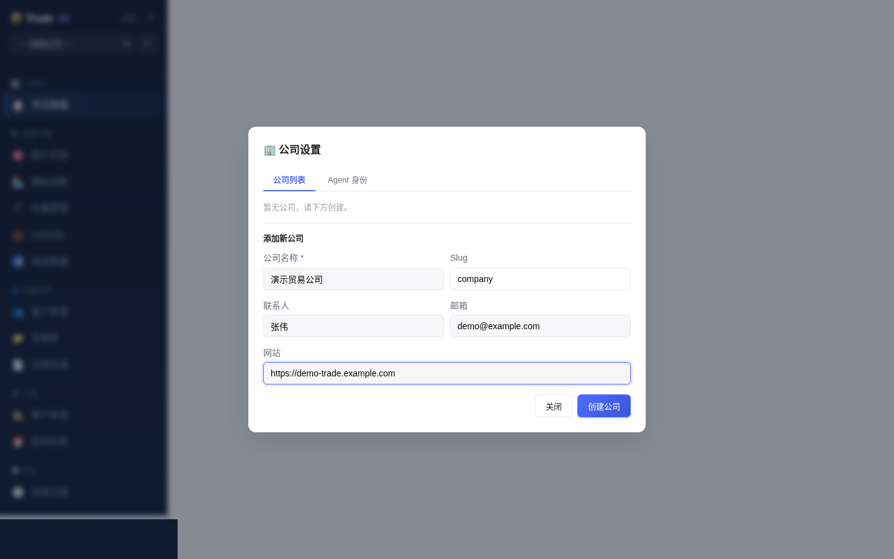
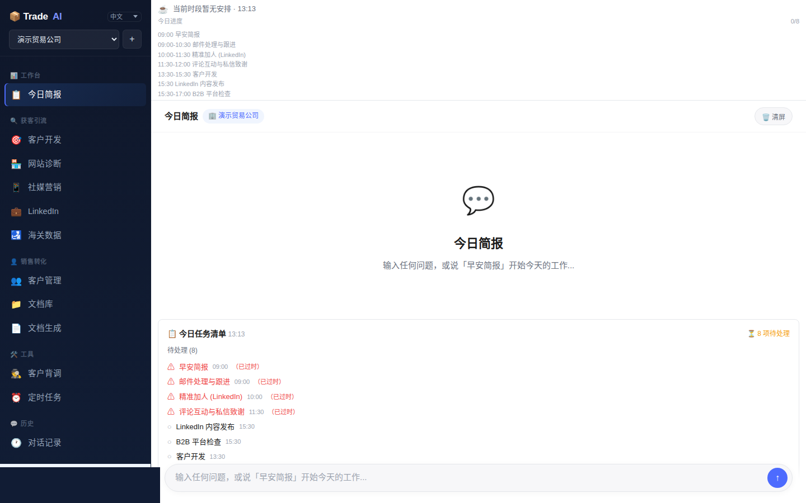
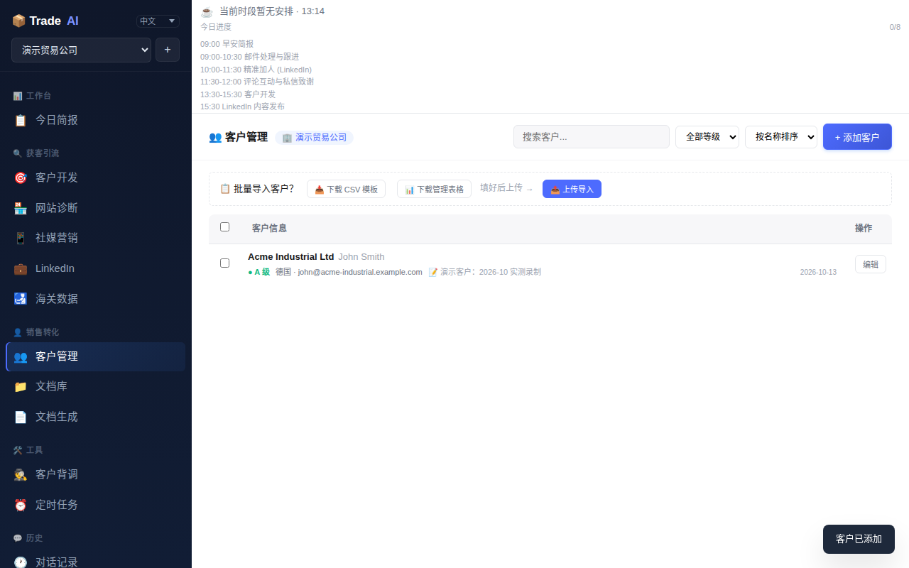
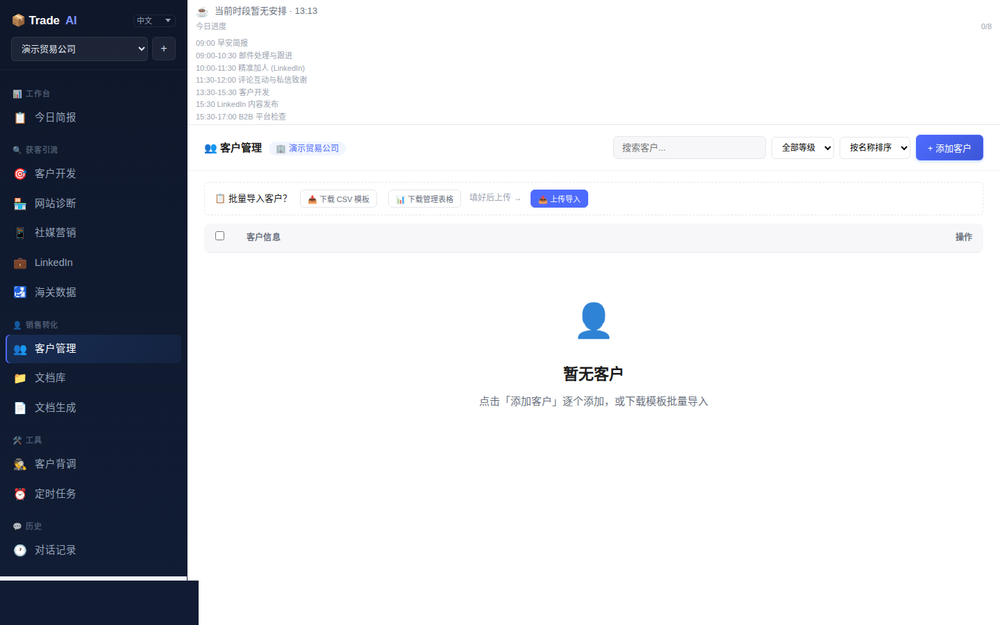
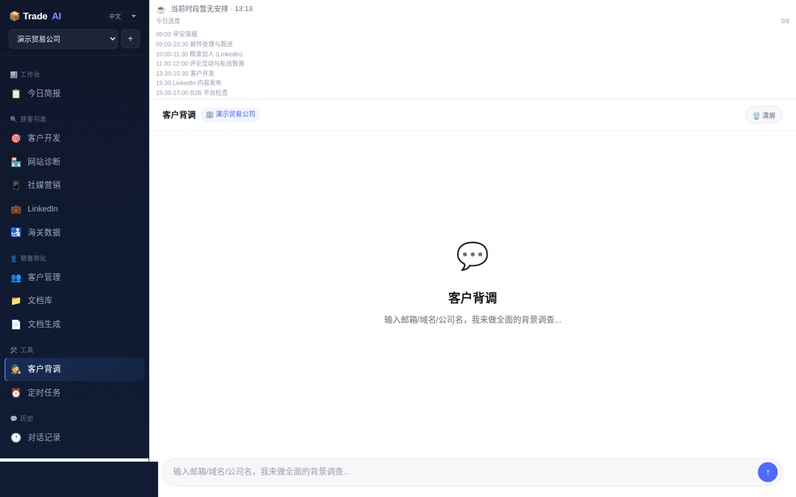
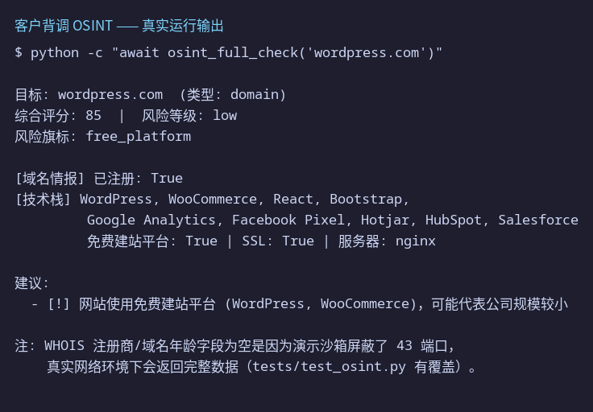
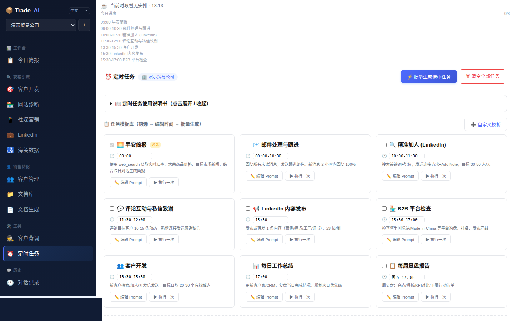

# Smart Trade AI —— 项目介绍与使用说明书

> 实测版本：v0.6.8（commit `0719509`）
> 实测日期：2026-10-13
> 实测环境：Linux + Python 3.12.3，全新克隆、全新虚拟环境安装
>
> 本说明书所有截图、动图、终端输出均来自本次真实安装与运行，非示意。

---

## 1. 这是什么

**Smart Trade AI**（仓库名 `smart-trade-ai`，产品名 Foreign Trade Assistant / Trade AI）是一个**面向外贸销售的 AI 助手**：本地运行的 Web 服务，把"查客户、写开发信、跟进、定时任务"这些日常工作收进一个聊天界面，后面接的是大模型（DeepSeek 等）+ Hermes Agent 引擎。

它解决的麻烦（来自官方文档）：

| 你平时的麻烦 | 用了它之后 |
|---|---|
| 每天打开好几个网站查汇率、金价、新闻 | 每天早上自动生成一份简报，汇率、行情、客户提醒全在里面 |
| 想了解新客户靠不靠谱，不知道从哪查 | 输入邮箱或公司名，自动查域名、制裁名单、LinkedIn 等 6 项 |
| 给客户写开发信，每封都要重新想 | 告诉它客户是做什么的，它帮你写好开发信 |
| 阿里国际站、中国制造网要每天登录看新询盘 | 它定时帮你检查，有新的就提醒你 |
| 客户资料散落在微信、Excel、邮件里 | 统一管理，按 A/B/C 分级，还能关联合同文件 |
| 不知道 LinkedIn 该发什么 | 每周帮你规划好要发什么，轮换不同话题 |

### 技术架构

```
浏览器 → http://127.0.0.1:9119/trade （FastAPI + static/trade_chat.html）
            │
            ├─ /api/trade/*  业务接口（客户、公司、订单、定时任务、记忆…）
            ├─ /api/status   服务状态 + doctor 自检结果
            │
            ├─ trade/        业务层（OSINT 背调、客户管理、skill 路由…）
            ├─ Hermes Agent  AI 引擎（版本 0.21.5，单独仓库，editable 安装；安装脚本钉 tag v2026.9.24）
            └─ SQLite        本地数据（~/.trade/data/trade.db，多公司隔离）
```

- **Python**：要求 ≥3.11（实测用 3.12.3）
- **AI 模型**：通过 `hermes setup` 配置，推荐 DeepSeek（便宜），兼容 OpenAI / Anthropic / GLM / Kimi / Ollama
- **测试**：全量 812 个（撰写时仓库计数），本次实测环境抽查核心子集全部通过

---

## 2. 安装实录（我真实走了一遍）

以下每一步都在干净环境执行过，命令可直接照抄。

### 2.1 克隆与依赖安装

```bash
# 1. 克隆
git clone https://github.com/chefroger/smart-trade-ai
cd smart-trade-ai

# 2. 建虚拟环境并装依赖
python3 -m venv venv
venv/bin/pip install -r requirements.txt

# 3. 安装 Hermes Agent（AI 引擎，必须用安装脚本钉死的 tag v2026.9.24）
#    别用 main / v0.21.6+：上游从 v0.21.6 起把核心依赖标成 Python 3.14+，
#    在 3.11–3.13 上装出来会缺一整套依赖
git clone --depth 1 --branch v2026.9.24 \
  https://github.com/NousResearch/hermes-agent.git
venv/bin/pip install -e ./hermes-agent

# 4. 安装 trade 本体
venv/bin/pip install -e .
```

### 2.2 安装中遇到的坑（已验证解法）

| 现象 | 原因 | 解法 |
|---|---|---|
| `trade doctor` 报 `No module named 'ruamel'` / `'requests'` 等，Agent 构造失败 | **装到了 Hermes v0.21.6+ 的代码**：上游从这一版起把 45/46 条核心依赖都标成 `; python_version >= '3.14'`，在 Python 3.11–3.13 上 `pip install -e` 一条依赖都不装 | 改用安装脚本/README 钉住的 tag：`git clone --branch v2026.9.24`（实测 3.13 装完 64 个包、依赖齐全）。只有 2 个模块缺失时也可 `pip install "ruamel.yaml" requests` 临时补，但整条依赖链都缺，不推荐 |
| 跑测试时 async 用例失败 | 缺 `pytest-asyncio`（在 pyproject 的 dev 依赖里，不在 requirements.txt） | `venv/bin/pip install pytest-asyncio` |
| `/tmp` 写满导致安装失败 | 沙箱的 /tmp 是 512M 内存盘；venv + hermes-agent 约 500M | 把环境建在磁盘目录（如 `~/workspace`），别放 /tmp |

### 2.3 自检与启动

```bash
# 自检（下面是真实输出截图）
venv/bin/trade doctor

# 启动服务（--no-browser 不自动弹浏览器，--no-gateway 跳过 Hermes 网关）
venv/bin/python server.py --port 9119 --no-browser --no-gateway
# 浏览器打开 http://127.0.0.1:9119/trade
```



> 截图中错误提示里的 `trade setup` 是当时的文案；最新代码已更正为真实存在的
> `hermes setup`（本说明正文按更正后的写法给出）。

自检是诚实的：`✓` 是真可用，`⚠` 是降级可用（如没装 Tavily Key 就降级搜索），`✗` 会明确告诉你缺什么。上图里唯一的 `✗` 是"未配置 AI 模型"——因为演示环境没有放 API Key，`hermes setup` 配好即消失。

服务状态接口连自检结果一起返回，方便监控：

```
GET /api/status → {"status":"ok","app":"Foreign Trade Assistant",
                   "version":"0.6.8","doctor":{...}}
```

---

## 3. 功能演示

### 3.1 主界面与多公司架构

首次打开会看到欢迎页，Trade AI 是**多公司隔离架构**——先选公司或创建公司，所有客户、任务、记忆都按公司隔离。



创建公司只需要填名称（Slug 自动生成），联系人、邮箱、网站选填：



### 3.2 今日简报（工作台首页）

选定公司后进入工作台：顶部是今日任务清单（定时任务到点会自动打勾/标过期），下方是聊天框——输入问题，或说"早安简报"开始一天的工作。



### 3.3 客户管理

客户列表支持搜索、按等级筛选、排序；支持**批量导入**（下载 CSV 模板 → 填好上传）。下面这段动图是真实操作录屏：打开"添加客户" → 填写 → 保存 → 出现在列表（A 级、德国）：


添加后的客户行（注意 A 级徽标和备注）：





### 3.4 客户背调（OSINT）

在"客户背调"输入邮箱 / 域名 / 公司名，自动做 6 层检查：① 邮箱注册检测（holehe，122 个平台）② 域名情报（WHOIS 注册/年龄）③ 企业邮箱验证（MX 记录 / 个人邮箱域名判别）④ 技术栈检测 ⑤ 制裁名单筛查（OFAC/UN）⑥ LinkedIn 公司页核查（生成浏览器操作指令）。最后出综合评分和风险旗标。



下面是**真实运行**的背调输出（`osint_full_check('wordpress.com')`），注意 `free_platform` 这个风险旗标——它正是靠"拿建站平台域名去页面源码里找"来判定的：



> 该截图拍摄于技术栈检测**收紧之前**：图中的 Hotjar / HubSpot / Salesforce 其实只是
> 被页面**提及**（不是真在用），正是这次要修掉的误报。现在检测已改为"域名/路径锚定"
> （如 `js.stripe.com`、`static.hotjar.com`），同一命令不会再列出仅被提及的产品。


### 3.5 定时任务

任务模板库：早安简报、邮件处理与跟进、LinkedIn 精准加人、评论互动、B2B 平台检查、每日/周复盘……每个模板可**编辑 Prompt**、可**执行一次**、可勾选后**批量生成**为定时任务。到点自动执行，结果进简报。



---

## 4. 使用说明

### 4.1 首次启动三步走

1. **装**：照第 2 章装完，跑 `trade doctor` 确认只有"未配置 AI 模型"一项致命。
2. **配模型**：`hermes setup` 按提示选模型并填 API Key（DeepSeek 最便宜；有 Tavily Key 的话也填上，背调质量更高）。
3. **开**：`trade`（或 `python server.py`），浏览器打开 `http://127.0.0.1:9119/trade`，创建公司，开始用。

### 4.2 日常工作流建议

- **早上**：打开"今日简报"，说"早安简报"——汇率、大宗商品价格、目标市场新闻、待办客户一次看完。
- **来新询盘**：把对方邮箱/域名丢进"客户背调"，先看风险评分和制裁筛查，再决定投入多少精力。
  也可以在命令行直接跑（6 层判定与聊天里同一条管线）：`python -m trade.osint <邮箱|域名|公司名>`，加 `--json` 输出结构化结果。
- **写开发信**：在"客户开发"里告诉它客户是做什么的、你的产品定位，它按 B2B 话术写好。
- **防忘记**：跟进任务做成定时任务（如"每周三提醒我跟进 A 级客户"），到点它会提醒。
- **客户多了**：用 CSV 批量导入，A/B/C 分级 + 搜索筛选（界面搜索框目前是本地关键词过滤；语义检索的后端接口已就绪，界面接线后可用）。

### 4.3 数据与备份

- 数据在 `~/.trade/data/trade.db`（SQLite，单文件，拷走即备份）。
- 换电脑：把 `~/.trade` 整个拷过去即可。
- `trade doctor` 是日常体检入口，任何功能异常先跑它，看 `✗` 项。

---

## 5. 排障速查

| 症状 | 先看 |
|---|---|
| 页面打不开 | 服务是否在跑：`curl http://127.0.0.1:9119/api/status`；端口是否被占（默认 9119） |
| 聊天没回复 / 报错 | `trade doctor` 的"Agent 构造"和"对话回合"两项；十有八九是没跑 `hermes setup` 配 Key |
| 背调结果字段为空 | 沙箱/内网可能屏蔽 WHOIS 43 端口或制裁名单源；`tests/test_osint.py` 可本地验证逻辑 |
| 安装时 hermes 装完版本不对 / 缺模块 | install.sh 钉的是 tag `v2026.9.24`；`git clone --branch v2026.9.24` 别用 main（v0.21.6+ 的依赖被标成 Python 3.14+，3.11–3.13 上装不出依赖） |
| 界面搜不到某客户 | 界面搜索框是**本地关键词过滤**（匹配名称/联系人）；语义检索仅后端接口（`/api/trade/customers/search`）已就绪，界面接入前不生效 |

---

*本说明书由 Muse 在全新安装环境中实测编写：克隆 → 安装 → 自检 → 启动 → 截图/录屏 → OSINT 实测，所有素材均为真实运行产物。*
